# 第 4 章設計報告｜Chapter 4 design report

> **狀態：候選版本，尚未發布。** 分支 `feat/chapter-04-antibiotic-resistance`，基線是正式版 v0.10（`3c858f6`）。這一章還沒有經過維護者試玩驗收，也沒有任何外部玩家玩過；線上的正式版本仍是 v0.10。
>
> *Status: release candidate, not released. Based on v0.10. Not yet playtested or accepted by the maintainer. This report covers what Chapter 4 is, why it is built this way, how it was tested, what was checked against sources, and what is still unverified. A short English summary is at the end.*

這份文件給審查的人看：做了什麼、為什麼這樣做、怎麼測的、哪些地方沒有把握。

## 一句話

**第 4 章｜漏網之魚：抗生素與抗藥性**（*The Ones That Got Away*）。抗生素把它殺得死的細菌一次殺光，剩下那幾隻繼續分裂。藥沒有改變細菌，只決定了誰留下來。

## 設計理念

### 1. 同一個原理，兩個方向

v0.10 最重要的一個機制是第 2 章的淋巴結：每個 T 細胞天生帶著不同的受體，病毒的特徵把吻合的那一個**挑出來**複製。這叫株系選擇，它是一次對玩家有利的篩選。

抗藥性是同一件事反過來：細菌之間事先就有差異，抗生素把它殺不死的**留下來**複製。兩邊都沒有誰「學會」什麼。第 4 章就是要讓玩家在已經親手做過一次篩選之後，站到被篩選的另一邊。第二場戰鬥打贏時，結算頁把這兩件事並排寫出來；圖鑑多了一則「篩選」。

這也直接對應任務要求避免的兩個誤解：「細菌有意識地適應」和「人體產生抗藥性」。在這個框架裡，這兩句話根本說不通：差異在用藥之前就在，變的是族群的組成，而且變的是細菌。

### 2. 第 1 章留下的伏筆

第 1 章的戰場在皮膚外面畫了五隻表情平靜的細菌，圖鑑寫著「不是所有細菌都有害。皮膚上住著許多無害、甚至有益的細菌」。在 v0.10 裡那只是背景。

第 4 章把那一排變成狀態：12 個位子，住著無害的**住戶**、平常無害但闖進傷口會造成感染的**伺機菌**，以及其中一隻這種抗生素殺不死的**條紋菌**。它由存檔裡的 `bodySeed` 決定，從第一天就在那裡，和淋巴結裡那個「一直都在」的 T 細胞是同一種寫法。這一排會存進存檔，出現在主選單的記憶冊旁邊：身體記得打過的病毒，皮膚上的細菌也留著被篩選過的痕跡。

### 3. 玩家只決定真實世界裡真的由他決定的事

**這一章的戰場上沒有「抗生素」按鈕。** 藥是醫師開的，在固定的回合自動送到，療程固定 2 回合；提早打贏，療程也照樣吃完。整章唯一由玩家決定的用藥，是感冒那天要不要吃室友給的抗生素。

這不是一開始的設計，是被獨立審查推翻之後重做的結果，經過寫在下面「被推翻的第一版」。它現在是這一章我最有把握的決定：一般人在真實世界裡握有的，正是「要不要吃不是開給自己的藥」「要不要為了感冒去要抗生素」這一類決定；而「什麼時候開始、吃幾天」不該由玩家來鑽研。

## 玩家實際經歷

大約 8 到 12 分鐘。

| | 發生什麼 | 玩家帶走什麼 |
|---|---|---|
| **練習 1** | 10 隻細菌，一個巨噬細胞，一口只能吞一隻。忙一回合之後，醫師開的抗生素送到，一次全部殺光。 | 抗生素是體外來的幫手；它攻擊細菌才有的構造 |
| **練習 2** | 藥第 3 回合才到。第 1 回合結束時，一隻細菌分裂時「複製出錯」，長出條紋，這時還沒有用藥。提示問：藥送到之後誰會留下來？藥到，其餘全死，只剩有條紋的，而且沒有對手之後越長越多。 | 突變發生在用藥之前；藥只決定誰留下來 |
| **練習 3** | 第一次注意最上面那一排皮膚上的細菌。療程的每一回合，緊鄰條紋菌的一個細菌死掉，由條紋菌補位。 | 抗生素分不出誰是住戶；每個療程都有固定的代價 |
| **第一道傷口** | 16 隻細菌闖進來，4 隻有條紋，分散在不同格。第 1 回合是布陣：要先吞掉會傷到組織的滿載菌落，還是先靠近藥殺不死的那幾隻？第 2 回合藥到，之後是巨噬細胞追條紋菌。 | 藥處理多數，免疫細胞處理漏網的 |
| **感冒那天** | 室友遞來半盒抗生素。吃或不吃。吃了：病毒一個也沒少，皮膚上又被換掉兩個位子。 | 抗生素對病毒無效；不必要的療程一樣要付代價 |
| **第二道傷口** | 闖進來的細菌從皮膚來。沒吃藥的人面對大約 4 隻條紋菌，吃了的人大約 7 隻，回合數差不多加倍。結算頁把兩次的紀錄並排；可以回到感冒那天重選。 | 後果是自己留下的 |

章節結束後，主選單多一張「皮膚上的細菌」卡片，圖鑑解鎖四則：抗生素、抗藥性細菌、皮膚上的住戶、篩選。

## 抗藥性在遊戲裡怎麼呈現

- **一隻一隻記錄。** 組織裡每一隻細菌不是「怕藥」就是「帶抗藥基因」（畫成條紋加金色外圈，不只靠顏色）。分裂時子代和親代一樣。
- **突變是偶然的，而且看得見。** 沒有條紋的細菌分裂時有 3% 的機會抄錯。發生時畫面上跳出「複製出錯！」，提示第一句就是「現在並沒有在用藥」。
- **藥只做一件事。** 送到的那一刻，沒有條紋的全部死亡，有條紋的原地不動。
- **競爭釋放。** 一格最多 3 隻；怕藥的死光之後，條紋菌有了空間，分裂、擴散都不再被擋。這不是另外寫的規則，是原本的格子容量自己產生的。
- **免疫細胞不分。** 巨噬細胞吞條紋菌和吞一般細菌一樣快。抗藥性是「這種藥對它沒用」，不是「什麼都對它沒用」。
- **皮膚上的代價。** 療程的每一回合，皮膚上緊鄰條紋菌的一個細菌（不管是住戶還是伺機菌）死掉，由條紋菌補位。一個療程固定 2 格。
- **後果會帶到下一場。** 闖進傷口的細菌裡條紋的比例，等於皮膚上伺機菌裡條紋的比例。
- **有限度的恢復。** 幾個月沒有用藥，會有一格由原本怕藥的細菌長回來。

## 被推翻的第一版

第一個候選版本（commit `3da662d`）是這樣的：戰場上有一顆「抗生素」按鈕，玩家決定什麼時候按；按下去之後藥持續到這一場結束，每多一回合皮膚上就多換掉一格。我的想法是讓「打得好」直接減少代價。

獨立審查的 AI 代理人用機器人跑了規則層，指出這個設計的最佳策略：

| 第一版的打法 | 第一場勝率 | 皮膚上條紋菌 | 第二場勝率 |
|---|---|---|---|
| 第 1 回合就用藥 | 100% | 2.9 | 89% |
| 先吞掉條紋菌，最後才用藥 | 100% | 2.0 | 99.8% |

也就是說，**遊戲獎勵「把醫師開的藥壓著晚一點用」**，練習 3 的文字還明白教這件事；而「藥持續到感染清除」又等於「好了就停」。免責聲明寫在規則卡裡，但玩家學到的是機制。這正是任務書明文禁止的那種對應。

我接著試了「按鈕保留、療程固定」的中間方案，模擬顯示條紋菌多的時候晚按反而勝率更高（怕藥的細菌佔著格子，壓住了條紋菌）。所以最後把按鈕整個拿掉。

重做之後，同一批問題的現況：

- 玩家沒有任何辦法延後、縮短或停止用藥。
- 一個療程對皮膚的代價固定是 2 格，和打得快慢無關；贏了也把療程吃完。
- 正確用藥一次之後，皮膚上條紋菌的比例從 17% 到約 30%，不再是第一版的 47%；下一場照樣能打。
- 第一場從平均 1.9 回合變成 3 回合，條紋菌分散在不同格，第 1 回合的布陣是真的取捨。

## 平衡

規則層機器人，固定種子（`s*7919`），每格 300 局。機器人是貪婪的，比第一次玩的人穩，數字只能說明相對形狀。星數門檻：組織健康 95%／80%。

| 情境 | 開戰時條紋菌 | 打法 | 勝率 | 平均回合 | 三星／兩星／一星 |
|---|---|---|---|---|---|
| 第一道傷口 | 4.0 | 優先處理條紋菌 | 100% | 3.0 | 105／195／0 |
| | | 不分優先 | 100% | 3.6 | 189／111／0 |
| | | 什麼都不做 | 0% | | |
| 第一道傷口，假如藥永遠不來 | 4.0 | 優先處理條紋菌 | 0% | | |
| 第二道傷口（感冒時沒吃） | 4.4 | 優先處理條紋菌 | 100% | 3.1 | 171／129／0 |
| 第二道傷口（感冒時吃了） | 7.3 | 優先處理條紋菌 | 85% | 5.9 | 112／127／15 |
| | | 不分優先 | 96% | 6.0 | |

讀法：

- 沒有抗生素，這種感染打不贏（0%）。這是刻意的：需要的時候，它是救命的工具。
- 有抗生素、但什麼都不做，也打不贏。藥不是全部。
- 「不分優先」的機器人三星比較多：第 1 回合先吞掉滿載菌落能少受傷，先靠近條紋菌則之後打得快。兩種打法各有所長，這是我想要的。
- 感冒時多吃一個療程，下一場條紋菌多三隻、回合數加倍、偶爾會輸，但不是死路。

## 科學查證與遊戲簡化

19 條敘述交給一個 AI 代理人，要求它實際開啟原始頁面逐條比對並附上原文引句。結果：9 條直接支持、10 條調整措辭後採用、沒有被判為錯誤的；另有三個子項找不到可讀的來源，遊戲裡沒有使用。**這是 AI 輔助的資料比對，不是醫學專業審查。**

依查證結果改掉的說法：

| 原本想寫 | 問題 | 現在的寫法 |
|---|---|---|
| 抗生素不傷你的細胞 | 粒線體有類似細菌的核糖體；抗生素有副作用 | 「受到的影響小得多」；說明頁註明可能有副作用 |
| 有沒有用藥，突變機會都一樣 | 某些抗生素的壓力會提高突變頻率 | 「突變是偶然的，藥不能指定它出現」；說明頁補充這一點 |
| 免疫細胞會把漏網的清掉 | 來源是數學模型；對免疫力弱的人與嚴重感染不成立 | 第二場結算頁固定加一段「真實世界裡比較難治」；說明頁註明不能期待它自己好 |
| 停藥後抗藥細菌會減少 | 研究顯示社群層次的逆轉很慢 | 遊戲只恢復一格；說明頁寫明真實通常很慢、可能不恢復 |
| 每年 127 萬人死亡 | 是 2019 年的模型估計，WHO 現行頁面已改用別的數字 | 遊戲裡沒有放任何死亡數字 |
| 住戶細菌無害 | 在導管、植入物或免疫力弱時會造成感染 | 圖鑑註明 |

關於療程：查證時找到 WHO 的說法是「一律照醫療人員的指示」，並提到某些感染較短的療程可能一樣有效；CDC 的病人頁面寫「照處方服用」。兩者都沒有叫病人自己決定長短。遊戲的文字只說「照指示使用，不要自己停藥、延長或加藥」，不說「一定要吃完」，也不說「好了就可以停」。

主要來源（完整清單在 README）：OpenStax *Microbiology* 11.5、14.1–14.3、14.5、21.1；CDC 的抗藥性與抗生素使用頁面；WHO 抗微生物藥物抗藥性事實說明；Buffie & Pamer 2013；Ankomah & Levin 2014（數學模型）；Andersson & Hughes 2010（只讀摘要）；Kohanski et al. 2010（只讀摘要）；Martinez & Baquero 2000。CDC 頁面是透過摘要工具讀取的，引句沒有逐字核對。

遊戲為了好玩而做的簡化，全部列在遊戲內「這款遊戲簡化了什麼」的第 4 章一節，共 19 條。最重要的幾條：

- 戰場上沒有抗生素按鈕是刻意的；這一章不是用藥建議。
- 「療程 2 回合、固定換掉皮膚上 2 格」是遊戲設定，不代表真實療程的長度或影響。
- 只有一種抗生素、一種抗藥性。
- 條紋是記號，真實的抗藥細菌外觀看不出來，要靠檢驗。
- 突變機率 3% 比真實高出許多個數量級；練習 2 的突變是安排好的。
- 抗藥基因在細菌之間直接傳遞（水平基因轉移）沒有呈現。
- 「巨噬細胞把漏網的清掉」是簡化；抗藥細菌造成的感染可能很嚴重。
- 皮膚上「12 個位子、三種細菌」是示意，也用來代表腸道等其他部位的菌群。

## 和前三章的連貫

- **故事。** 「一年後，這次的傷口比較深」。同一個身體，同一塊皮膚，第 1 章的傷口與巨噬細胞原樣回來。感冒那天的卡片提到偵察兵、T 細胞與抗體，是第 2、3 章的事。
- **規則。** 六角格、行動點數、一格最多 3 隻、滿載擴散並傷到組織、守在路上可以攔截、回合結束前的預告，都和第 1 章相同。這一章沒有發炎與嗜中性球：一次只多一樣新東西。
- **結構。** 三個練習各帶一個概念，再接正式戰鬥；兩場戰鬥之間是一個選擇，打完可以回到選擇點比較。這是第 3 章「疫苗」的結構，這次鏡像過來：第 3 章是做了準備所以下一場比較好打，第 4 章是多做了不必要的事所以下一場比較難打。
- **存檔。** 沿用 `iw_body_v1`，多了 `flora`（皮膚菌群）與 `ch.abx`、`hist.abx*`。沒有改存檔版本，舊存檔可以直接用。
- **入口。** 第 3 章打完的主要按鈕改成「第 4 章：漏網之魚」。沒玩過前三章也能直接開始第 4 章。

## 對既有程式的修改

| 檔案 | 修改 | 對前三章的影響 |
|---|---|---|
| `js/rules.js` | 檔尾新增 `IW.abx` 一節（約 125 行） | 沒有。`git diff v0.10 -- js/rules.js` 沒有任何刪除或修改的行 |
| `js/mode-abx.js` | 新檔案：第 4 章的畫面、操作、提示、結算與流程 | 沒有 |
| `js/art.js` | `A.rod` 多一個選用的第 8 個參數（畫條紋）；新增 `A.coccus`、`A.pill` | 沒有。前三章的呼叫都不傳第 8 個參數，畫法不變 |
| `js/battle.js` | 結算時間軸多一個選用的 `sameScale`（兩條線共用刻度） | 沒有。前三章沒有設定這個選項 |
| `js/app.js` | 主選單第 4 張章節卡、皮膚菌群卡、4 則圖鑑、說明頁第 4 章一節、參考資料、版本文字 | 主選單與說明頁多了內容 |
| `js/mode-airway.js` | 第 3 章打完的主要按鈕改成前往第 4 章 | **有**：原本的主要按鈕「回主選單看記憶冊」變成次要按鈕 |
| `css/game.css` | `.card>*{flex-shrink:0}` | **有，是修正**：結算卡內容超過螢幕高度時，時間軸與圖表原本會被壓成零高度而消失 |
| `index.html` | 多載入一個檔案 | 沒有 |

沒有引入框架、建置步驟、測試框架或任何外部資源。

## 測試結果

全部是自動化操作與我自己看截圖。**不是真人試玩，不是教育成效研究，也不是實機測試。** 環境：macOS 上的 Playwright，Chromium 與 WebKit。測試腳本沒有放進專案。

| 項目 | 做法 | 結果 |
|---|---|---|
| 完整流程 | 機器人透過遊戲的操作層走完三個練習、第一場、感冒選擇（兩種都選）、第二場（兩種都打）。四種組合：Chromium 390×844 中文觸控、WebKit 390×844 英文觸控、Chromium 1280×720 英文滑鼠、WebKit 360×640 中文觸控 | 每種 27 項檢查，共 108 項通過；JavaScript 錯誤 0 |
| 真實輸入 | 用真實的點擊與觸控事件選取巨噬細胞並吞噬 | 通過 |
| 語言 | 戰鬥中來回切換語言，比對回合、行動點數、每一格的細菌、巨噬細胞位置與皮膚菌群 | 一致 |
| 規則是否如設計 | 練習 2 的突變發生在用藥之前；藥在指定回合自動送到；療程一定是 2 回合、皮膚一定是 +2；感冒時吃藥是「恢復 1 再 +2」，不吃只恢復 1；練習不影響存檔 | 通過 |
| 存檔與流程 | 在感冒結果卡關閉前離開再回來（選擇尚未寫入，重新詢問）；回到感冒那天重選；重試同一戰場不重播劇情卡；兩種紀錄都保留並出現在比較表 | 通過 |
| 版面 | 提示框與目標列有沒有文字被截掉 | 390×844 中文沒有；英文練習關卡的目標列曾超出，已縮短。360×640 這種矮螢幕上仍有超出（見已知限制） |
| 前三章 | `#skin`、`#airway`、`#return`、`#codex`、`#notes`、`#menu` 都能載入 | 通過。**沒有把前三章從頭打到尾** |
| 平衡 | 規則層模擬，見上方 | |
| 獨立審查 | 見下方 | |

### 獨立審查

一個沒有參與設計的 AI 代理人讀程式、用真實點擊與觸控實際操作、用自己的機器人跑規則層。它聲明自己不是醫療專業人員。第一輪針對第一個候選版本，找出：

| 嚴重度 | 問題 | 處理 |
|---|---|---|
| 阻擋 | 最佳策略是延後醫師開的抗生素，練習 3 明白教這件事；「持續到清除」等於「好了就停」 | 重做，見「被推翻的第一版」 |
| 重要 | 沒用藥就輸時，卡片說「抗生素是救命的工具」，即使那一場全是藥殺不死的細菌 | 藥改成一定會送到，這個情況不再存在；其餘結算文字改成依實際發生的事分支 |
| 重要 | 正確用藥一次就讓下一場幾乎無藥可用，卻給三顆星 | 療程代價固定為 2 格、幾個月後恢復 1 格、闖入的條紋菌數量照比例計算 |
| 重要 | 手機英文版的提示框把最重要的那一句截掉 | 所有提示改短，動作放在最前面 |
| 重要 | 第一場平均 1.9 回合就結束，不算戰鬥 | 16 隻、4 隻條紋、分散在不同格；現在平均 3 回合以上 |
| 重要 | 練習 2 沒用藥就輸時，卡片描述的是沒發生的事 | 改寫 |
| 重要 | 條紋菌對巨噬細胞來說不比一般細菌難處理，玩家可能以為抗藥感染沒什麼 | 第二場結算頁固定加一段真實世界的情況 |
| 重要 | 時間軸上「條紋菌」的線畫在「細菌總數」上面 | 兩條線共用刻度 |
| 次要 | 輸掉時菌群圖的標籤重疊；感冒結果卡前重新載入會跳過說明；重試會重播劇情卡；「從第一道傷口重來」留著舊紀錄；練習 2 先吞掉突變株時結語不對 | 都已修正 |
| 用語 | 「總有幾隻不怕它」暗示抗藥細菌永遠存在；「不再受影響」暗示細菌變了；英文 18 處 | 改寫；英文標題改為 *The Ones That Got Away* |

沒有處理的：跳過練習後離開再回來仍回到練習（前三章也是如此）；圖鑑要打完一場戰鬥才解鎖。

重做之後請同一個審查者複審，結果見文末「複審」。

## 已知限制與尚未驗證的事

- **沒有真人玩過。** 好不好玩、看不看得懂，這份文件裡沒有任何證據。
- **沒有實機。** iPhone、Android 手機都沒有碰過；WebKit 的結果不等於 iOS Safari。沒有 Firefox。
- **沒有醫學專業審查。** 也沒有教育成效研究。
- **英文沒有母語人士看過。**
- **聲音沒有聽過。** 這一章新增了抗生素送到與突變的音效，只確認過程式會呼叫。
- 前三章只做了載入層級的冒煙測試，沒有從頭打到尾重新驗證。
- 360×640 這類矮螢幕上，目標列只有一行，部分提示仍會超出提示框需要捲動。前三章也有同樣的限制。
- 手機英文版的三個狀態條標籤偏擠；紀錄表第一欄會折行。
- 一格上站著另一個巨噬細胞時，不能用點那一格的方式吞它腳下的細菌。和前三章相同；這一章細菌分散，比較容易遇到。
- 沒有「復原上一步」，也不能中途存檔。
- 皮膚菌群的恢復只發生在兩場戰鬥之間一次；重玩整章才會重新計算。
- 章節完成後重打第二場，主選單上的皮膚菌群會顯示最後一次打贏的結果。

## 自我批判

**最沒有把握的設計決定：把抗生素從玩家手上拿走。** 我認為這對訊息是對的，但它讓這一章的名字和玩家的手之間隔了一層：這一章叫抗生素，而玩家在戰場上從頭到尾沒有碰過它。玩家真正在做的事仍然是第 1 章的移動與吞噬。如果真人試玩的感想是「我只是在看藥自己來」，那麼這一章在遊戲性上就輸給了前三章，即使它在科學上站得住。我沒有辦法從模擬得知答案。

其他我不滿意或不確定的：

1. **第一版的方向是錯的，而我自己沒有發現。** 我為「讓技巧影響代價」寫了完整的規則、平衡與教學，直到獨立審查用數字指出來才看見它在教什麼。這說明我對「機制本身在教什麼」的檢查不夠，光靠免責文字不行。重做的版本同樣只有一輪審查。
2. **戰鬥偏容易。** 正確用藥的兩場，機器人 100% 過關。我用比較嚴的星數門檻讓結果有高下，但輸不了的戰鬥張力有限。這是為了「正確用藥不該被懲罰」所付的代價。
3. **感冒的選擇可能太明顯。** 兩顆按鈕只寫「吃」「不吃」，不帶提示；但大多數玩到第 4 章的人大概已經猜到答案。它的價值在於看見後果，而不是猜對。
4. **差別可能不夠有感。** 吃與不吃，下一場是 7 隻對 4 隻條紋菌。我刻意不做成天壤之別，因為誇大也是一種錯。但如果玩家只打其中一條路，他不會知道另一條路的樣子；比較表要回到選擇點重打才看得到兩列。
5. **「恢復一格」是一個我選的數字。** 太多會顯得抗藥性會自己好，太少又讓正確用藥顯得可怕。真實情況因細菌與藥物而異，沒有一個對的數字。
6. **「怕藥」是擬人的說法。** 中文口語很自然，英文用的是 *drug-sensitive*。說明頁加了一條解釋，但戰鬥中每一句提示都在用它。
7. **水平基因轉移沒有做。** 它是真實世界裡抗藥性擴散的主要途徑之一，在這一章只出現在圖鑑與說明頁的一句話。我判斷一次只教一件事比較重要，但這讓「突變」在玩家印象中的比重高過它在現實裡的比重。
8. **皮膚那一排很小。** 在手機上每個細菌只有十幾個像素寬，條紋要靠金色外圈才看得出來。它承擔了這一章最重要的訊息，卻是畫面上最小的東西。
9. **文字仍然不少。** 每場戰鬥前後的卡片、結算頁的說明加起來很長。結算頁在手機上要捲動兩個螢幕。
10. **我沒有玩過自己的遊戲。** 和上一輪一樣：我能確認流程走得完、數字合理、畫面沒破，但「第 1 回合該先吞哪一隻」這個決定好不好玩，是從機器人的星數分佈推測的。

## 怎麼試玩

```bash
git clone https://github.com/asid52714/immune-wars.git
cd immune-wars
git checkout feat/chapter-04-antibiotic-resistance
open index.html          # 或用瀏覽器直接開啟這個檔案
```

從主選單選第 4 章，或在網址後面加 `#abx`。建議的看法：

1. 不看任何文件，照畫面玩完三個練習與第一場。留意練習 2：看到條紋出現時，知不知道接下來會發生什麼。
2. 感冒那天先照直覺選，打完第二場；再用結算頁的「回到感冒那天，重新選擇」選另一邊，看比較表。
3. 用手機直向玩至少一場，留意最上面那一排看不看得清楚。
4. 想想看：打完之後，你覺得這一章在告訴你什麼？如果答案是「抗生素不好」或「抗藥性是因為沒把藥吃完」，那就是這一章失敗的地方，請告訴我們。

## 代表畫面

| | |
|---|---|
| 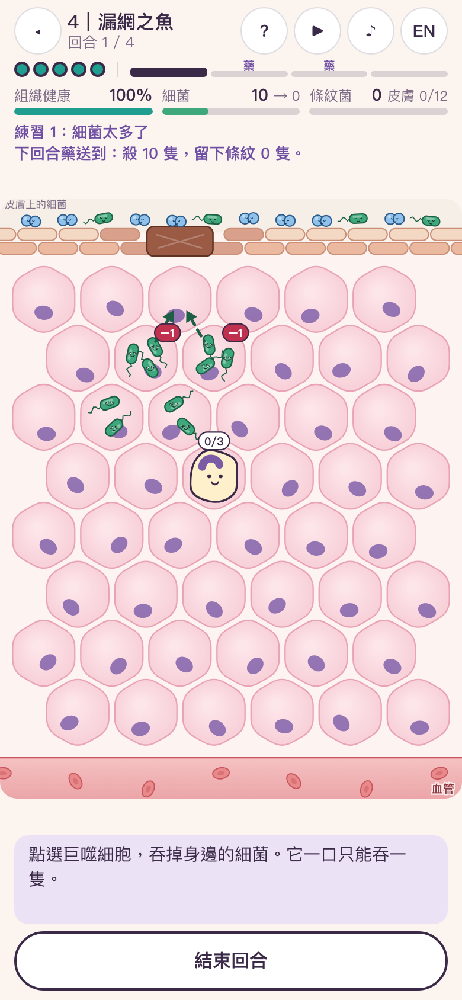 | 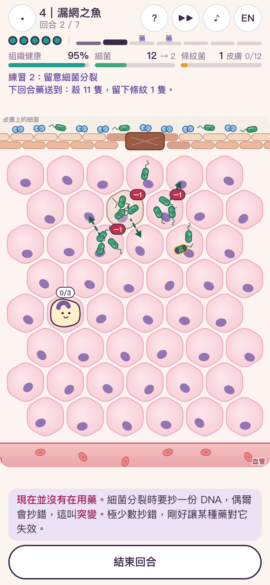 |
| 練習 1：細菌太多 | 練習 2：用藥之前，一隻細菌分裂時抄錯 |
| 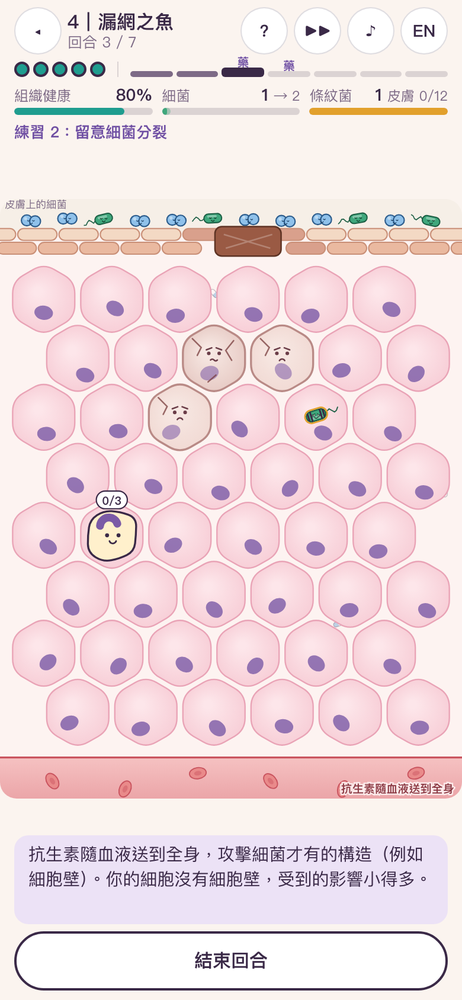 | 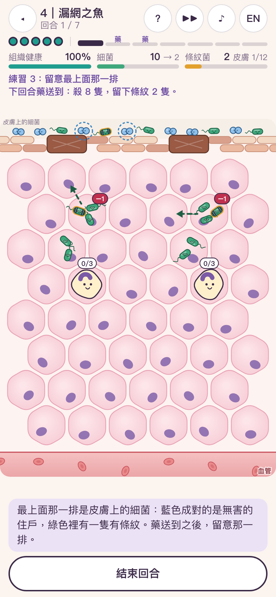 |
| 藥送到之後，只剩有條紋的 | 練習 3：最上面那一排是皮膚上的細菌 |
| 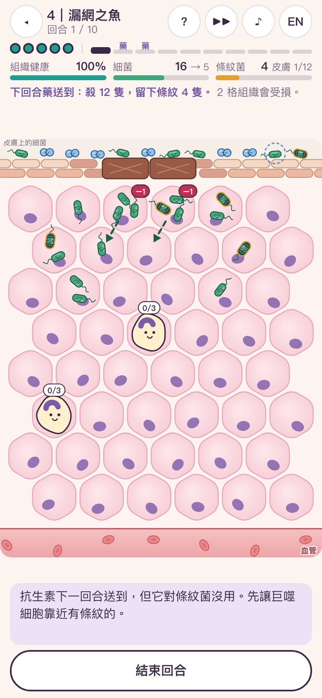 | 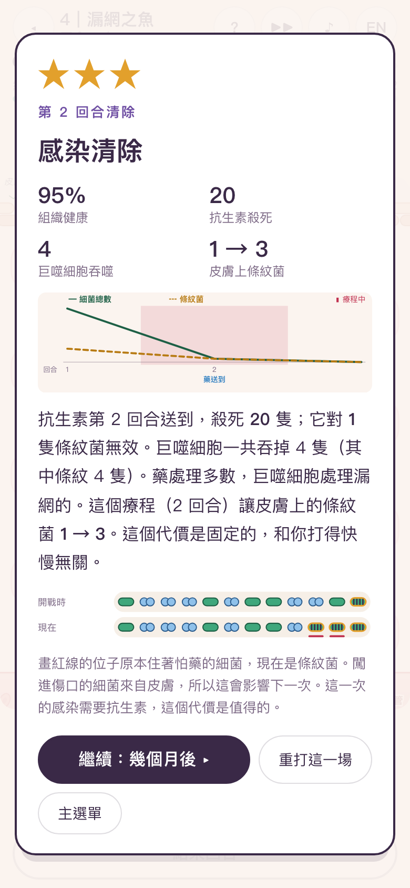 |
| 第一道傷口：下回合藥送到，會留下 4 隻 | 結算：這一局的時間軸與皮膚的變化 |
| 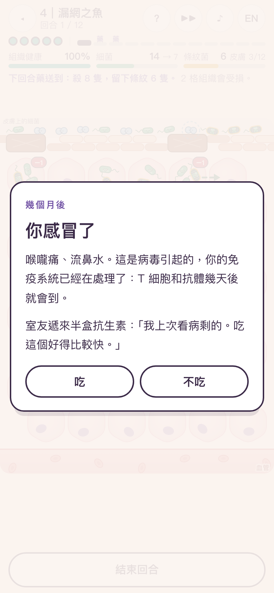 | 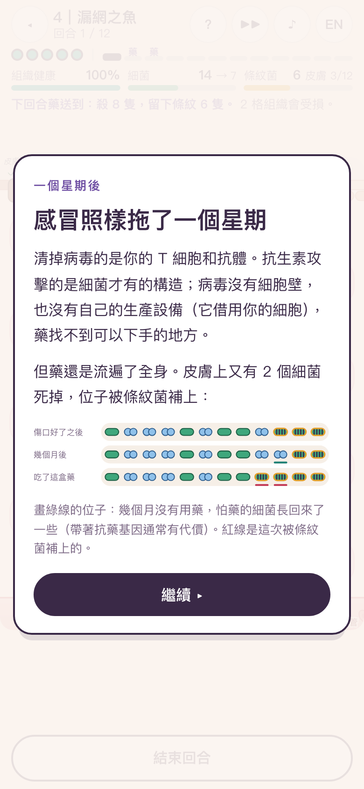 |
| 感冒那天：整章唯一的用藥決定 | 吃了：病毒沒少，皮膚又被篩選一次 |
| 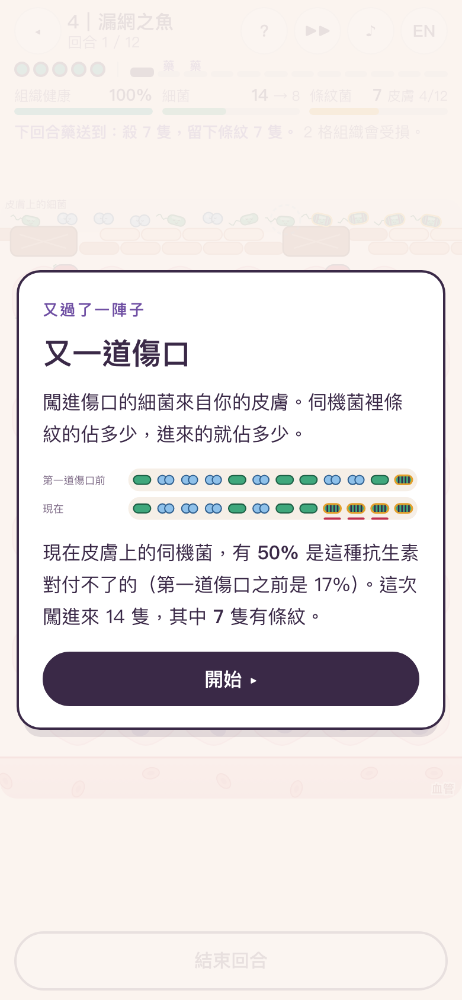 | 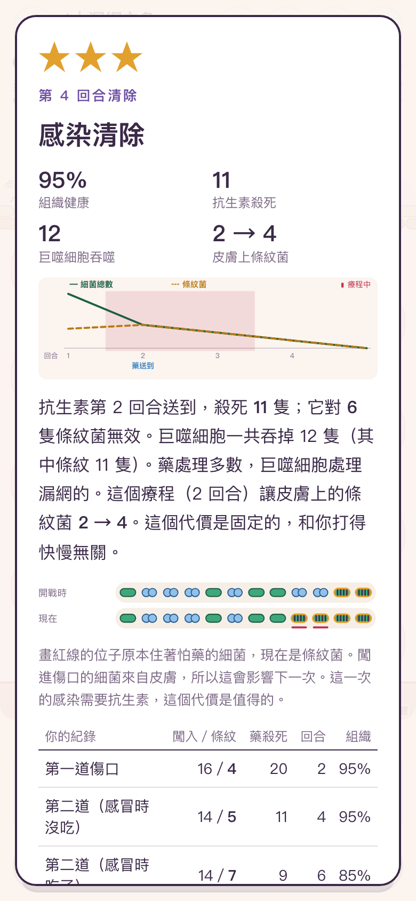 |
| 第二道傷口：細菌從皮膚來 | 自己的紀錄並排，以及「同一個原理，兩個方向」 |

桌面與英文：

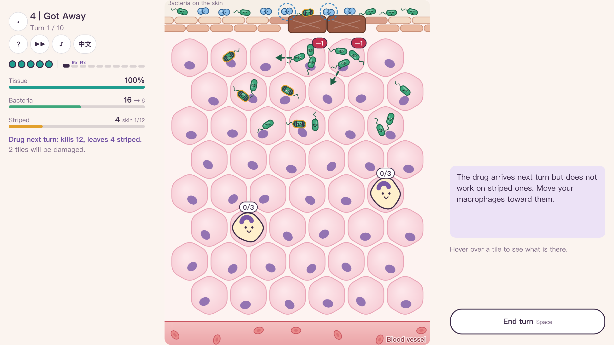

| | |
|---|---|
| 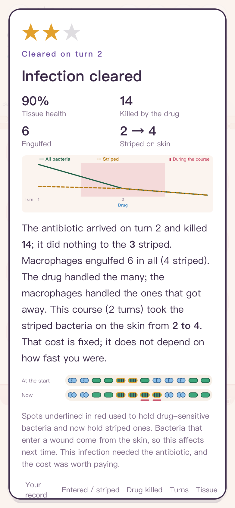 | 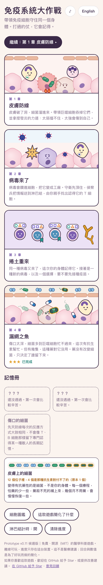 |
| 英文介面 | 主選單：第 4 章與皮膚菌群卡 |

## 複審

（重做之後的複審結果補在這裡。）

## English summary

**Chapter 4, "The Ones That Got Away": antibiotics and resistance.** Release candidate on branch `feat/chapter-04-antibiotic-resistance`; not yet playtested by the maintainer.

- **Idea.** The lymph node in Chapter 2 is selection working for the player: a virus's features single out the T cell that recognizes it, and it multiplies. Chapter 4 is the same principle the other way round: the antibiotic spares the bacteria it cannot kill, and they multiply. Nobody "learns" anything; the differences were there beforehand.
- **Play.** Three short practices (the drug; a mutation that appears before any drug is used and is the only thing left afterwards; the row of bacteria on the skin), then a deep wound, a choice about taking a roommate's leftover antibiotics for a cold, and a second wound seeded from whatever the skin now carries.
- **No antibiotic button.** The drug is prescribed, arrives by itself on a fixed turn and runs a fixed course. The first candidate let the player time it; an independent AI review showed that the winning strategy was then to hold back a prescribed drug, so that design was thrown out. The only drug decision the player makes is the one real people actually make.
- **Science.** Nineteen statements were checked by an AI agent against OpenStax, CDC, WHO and several papers (9 supported, 10 reworded, none wrong). This is not a medical review. Game-only abstractions are listed in the in-game "What this game simplifies" page.
- **Testing.** Automated play-throughs in Chromium and WebKit at four viewport/language/input combinations, rules-layer simulation for balance, and one round of independent AI review followed by a re-review. No human has played it, no real device has been used, the English has not been reviewed by a native speaker, and the sound has not been heard.
- **Least certain decision.** Taking the antibiotic out of the player's hands is right for the message, but it means the player never touches the thing the chapter is named after. Whether that plays well is a question only human playtesting can answer.
