# 改版候選版本說明｜Redesign Candidate

> 分支 `experiment/autonomous-redesign`，以 v0.9（`ee612d2`）為基線。
> 這是實驗性的產品改版，**尚未經過維護者驗收，沒有合併授權**，也沒有部署到線上。
>
> *An experimental redesign branched from v0.9. Not accepted by the maintainer, not merged, not deployed.*

這份文件給審查的人看：改了什麼、為什麼這樣改、怎麼測的、哪些地方還不夠好。

## 一句話

v0.9 的形狀是「看教學、打一場、讀檢討」，三關是三個互不相干的網頁。候選版本把它改成**同一個身體的三段經歷**：規則用小練習帶出來，適應性免疫由玩家在淋巴結親手完成，打過的病毒會留在記憶冊裡，下一次真的比較好打。

## 為什麼改

上一輪對 v0.9 的檢視（讀原始碼、在三種螢幕尺寸實際操作、規則層模擬）得到這些數字：

| 觀察 | v0.9 |
|---|---|
| 開場動畫長度（中文，照預設按鈕走） | 2:03／2:40／2:52 |
| 開戰前一次列出的規則 | 14／12／10 條 |
| 第 3 關第一場與第 2 關 | 同一個種子下動作數、回合、結果逐項相同 |
| 適應性免疫 | 取樣後固定等 3～4 回合；T 細胞與抗體是兩顆按鈕 |
| 手機直向的戰場 | 約佔螢幕高度四分之一，六角格 31～40px |
| 跨關卡的延續 | 沒有；進度、星數、記憶都不保存 |
| 三個關卡檔的重複 | 第 2 關 49% 的行與第 1 關相同，第 3 關 70% 與第 2 關相同 |

維護者試玩了上一輪的兩個實驗原型（邊玩邊學的第 1 關、淋巴結小玩法）之後，授權把這個方向做成完整的候選版本。

## 和 v0.9 的主要差異

| | v0.9 | 候選版本 |
|---|---|---|
| 結構 | 主選單＋三個各自獨立的單檔關卡 | 單一頁面，共用引擎；舊關卡網址轉址到對應章節 |
| 教學 | 戰前三段動畫＋一頁規則 | 每章三個半分鐘的練習，一次只多一條規則；規則頁隨時可看 |
| 第 1 章援軍 | 巨噬細胞（並在多處聲明沒有呈現嗜中性球） | 嗜中性球：來得快、不消化、很快離場 |
| 適應性免疫 | 取樣後倒數 3／4 回合 | 淋巴結：找出受體吻合的 T 細胞，找得越久後援越晚到（2～4 回合） |
| 免疫記憶 | 第 3 關同一戰場打兩次，對照表 | 存在存檔裡的記憶細胞。第 3 章規則和第 2 章完全相同，不同的只有身體 |
| 疫苗 | 第二場的前提設定 | 面對新病毒之前的一個選擇；選了就在沒有壓力的淋巴結先找一次 |
| 戰場 | 9×6 橫向，手機是把橫向畫布縮小 | 6×8 直向場景：體表在上、血管在下；桌面把寬度留給側欄 |
| 美術 | 深藍底、霓虹色、每個健康細胞都有笑臉 | 病理切片的 H&E 配色；健康細胞沒有表情，出事的才有 |
| 結算 | 星數、數字、五條知識重點、一段註記 | 星數、數字、這一局的時間軸（標出玩家做了什麼）、一句只針對這一局的話 |
| 知識內容 | 戰前必看 | 移到「細胞圖鑑」，遇過才解鎖，想看再看 |
| 簡化聲明 | 主選單、規則頁、進階選讀、結算頁各一段 | 集中在「這款遊戲簡化了什麼」一頁 |
| 進度 | 不保存 | localStorage：章節進度、星數、記憶冊、個人紀錄 |
| 其他 | | 敵方回合快轉、隨局勢變快的心跳聲、淋巴結放鬆模式（不計時） |

保留的東西：回合制與六角格、行動點數、回合結束前的預告（箭頭與損傷標記）、發炎的兩難、受害者與反派的表情原則、抗體不擬人、雙語就地成對的寫法（`tx('中文','English')`）、零安裝與離線可玩、沒有框架與外部資源。

## 設計決策與理由

### 1. 單一頁面，共用引擎

v0.9 的規則是「各關自包含單檔，不抽共用程式」。在只有一兩關時這是對的。到了第三關，手機版與雙語版都得把同一件事做三到四遍。更重要的是，獨立的網頁之間沒有可靠的共用狀態（離線開檔時連 localStorage 都不一定共用），所以「記憶」只能在單一關卡內用重打來模擬。

改成單頁之後，章節之間不重新載入，記憶冊在記憶體裡就是同一份。程式拆成八個檔，用傳統 `<script>` 載入，沒有建置步驟，雙擊 `index.html` 仍然能玩。規則層（`js/rules.js`）不碰畫面，平衡模擬直接呼叫它。

沒有做的：沒有引入框架、打包工具、測試框架或 CI。

### 2. 直向場景的戰場

戰場從 9×6 改成 6×8，體表在上、血管在下。這有三個理由：手機直向時戰場可以佔滿寬度（六角格約 57px 寬）；「援軍從血管來」變成畫面上看得到的方向；桌面多出來的寬度留給狀態與說明，不必把字疊在戰場上。

代價是所有數值都要重新平衡（見下方「平衡」）。

### 3. 邊玩邊學的練習

每章開頭是三個小戰場，每個只多一條規則：

- 第 1 章：吞噬 → 發炎求援 → 發炎的代價
- 第 2 章：病毒要進細胞 → 偵察兵與淋巴結 → 抗體與 T 細胞各管一種

第 1 章的第二個練習故意讓人先輸一次：七隻細菌、一個守衛，硬吃會逾時。輸了之後才提示用發炎。先產生問題再給答案，和 v0.9「先講答案再考試」的順序相反。

練習通過的進度會記住，再進同一章直接從正式戰鬥開始；規則頁有「重玩練習」。

### 4. 援軍改成嗜中性球

v0.9 的援軍是巨噬細胞，所以規則頁、進階選讀、結算註記都要聲明「真實情況中最先大量趕到的是嗜中性球，本關沒有呈現」。候選版本直接把援軍做成嗜中性球，並給它不同的手感：容量 3、不消化、吃飽或過 3 回合就離場。巨噬細胞是常駐、細水長流；嗜中性球是一次性的。離場時的提示會講到膿。

這也讓「發炎的格子被佔住時援軍不來」這個 v0.9 的邊角情況消失：援軍會落在發炎格的旁邊，只有場上完全沒有發炎才不來。

### 5. 淋巴結取代倒數計時

這是整個改版裡我認為最重要的一項。免疫學最反直覺的概念是株系選擇：受體是事先備好的，抗原只是把吻合的挑出來複製。它同時解釋了為什麼第一次慢、第二次快、為什麼記憶是專一的、為什麼疫苗有效。v0.9 把它壓成「等 3 回合」。

現在偵察兵取樣後，畫面切到淋巴結：20 個 T 細胞各帶一組三格的受體，找出和情報卡完全吻合的那一個。花的時間換算成後援抵達的回合數：

| | 找到的時間 | 毒殺 T 細胞 | 抗體 |
|---|---|---|---|
| 第一次遇到 | 7 秒內／14 秒內／更久 | 2／3／4 回合後 | 再晚 1 回合 |
| 有記憶細胞（4 個吻合） | 6 秒內／更久 | 1／2 回合後 | 同時 |

取捨：

- **即時計時放進回合制遊戲裡。** 這和其餘部分的節奏不一致，也對閱讀慢或操作不便的人不友善。我保留它，是因為上一輪原型裡「時間就是代價」正是讓概念有感的地方。補救是主選單的「淋巴結計時：關」，關掉後固定為第一次 3 回合、有記憶 1 回合。
- **第一次至少 2 回合。** 不管找多快，初次反應都比有記憶慢。這是刻意的：記憶的優勢是結構性的，不是手速。
- **這群細胞是固定的。** 由存檔裡的 `bodySeed` 決定，認得「病毒 乙」的那個細胞從第一天就在場。這是概念的一部分。
- **只找 T 細胞。** B 細胞同樣靠株系選擇，但再做一次會重複。它被濃縮成「抗體晚 1 回合」，並在圖鑑說明。

### 6. 記憶冊與第 3 章

打贏第 2 章，存檔裡多一張「病毒 甲」。第 3 章第一場是同一種病毒、同一套規則、不同的戰場，唯一的差別是淋巴結裡有 4 個記憶細胞。結算頁把這一場和玩家自己在第 2 章的紀錄並排。

接著是「病毒 乙」。它的情報卡不同，舊的記憶細胞對不上（點它們會說明原因）。玩家可以選擇先接種疫苗：在沒有計時、前線平靜的淋巴結找一次，留下記憶，再面對真的病毒。不接種也可以打，打贏後可以回到選擇點比較。

結算頁有一句提醒：差別不全來自免疫記憶，戰場不同，玩家也更熟練了。v0.9 用同一個種子打兩場來控制這個變因；候選版本放棄了這個控制，換來「這是我的身體」的連續感。這是一個我不確定的取捨（見「自我批判」）。

第 1 章的細菌**沒有**記憶卡。記憶冊裡有一格說明先天防線不會留下這種專一的長期記憶。上一輪提案裡我畫過「傷口的細菌：下次援軍提早一回合」，那是錯的，已經拿掉。

### 7. 圖鑑取代戰前動畫，簡化聲明集中一頁

v0.9 的戰前動畫沒有搬過來。它們的內容改寫成 13 則圖鑑條目（遇過才解鎖），每則是角色的圖、兩三句話，加上可展開的「想多知道一點」。

「只是比喻／不是醫療建議／遊戲化的簡化」集中到主選單的一頁，逐章列出。戰鬥中只在少數真的會誤導的地方保留一句（例如「發炎區的細菌無法擴散」是遊戲設定）。

### 8. 美術

- 配色取自 H&E 染色：組織是伊紅的粉，細胞核是蘇木的紫，紙白底。這是這個題材自己的樣子，和常見的深色科技風有區別，戶外看手機也清楚。
- 角色的輪廓取自真實形態：嗜中性球的細胞核分葉、淋巴球的細胞核幾乎佔滿細胞、巨噬細胞的細胞核凹陷、樹突細胞有突起、呼吸道上皮有纖毛。
- **健康的組織細胞沒有表情。** v0.9 有 54 張笑臉同時在場，受害者的表情反而不顯眼。現在只有受損、受感染的細胞有表情，並保留裂痕與顏色以外的辨識線索。
- 細菌是綠色、病毒是靛藍加洋紅棘突，在粉色組織上對比足夠。皮膚外的細菌是中性表情，延續「不是所有細菌都有害」。

### 9. 結算是一條自己的曲線

結算頁畫出這一局逐回合的兩條線（第 1 章：細菌數量與發炎程度；第 2、3 章：受感染細胞與細胞外病毒），在玩家促進發炎、調節發炎、取得情報、T 細胞與抗體到場的回合做記號，發炎傷到組織的回合用紅色區塊標出，再配一句只針對這一局的話。知識重點不在這裡重複。

### 10. 節奏與聲音

敵方回合可以切換兩倍速（設定會記住）。加了一個很輕的心跳聲，隨細菌數量、感染細胞數與組織損傷變快。聲音全部即時合成，可以靜音。**聲音我只能讀程式，沒有辦法聽**，音量與是否惱人需要真人判斷。

## 我推翻了自己上一輪提案的哪些部分

- **「不換六角格戰場、第一步只改教學結構」。** 上一輪我把重寫排在最後。實際動手後發現，直向戰場、新美術、共用引擎彼此綁在一起，分步做會把同一批程式改兩次。這一輪直接整個重寫，只把規則層的邏輯移植過來。
- **「戰前動畫移到圖鑑，打完解鎖」。** 動畫沒有保留。用新美術重畫九段動畫的成本很高，而練習關卡已經負擔了它們的工作。圖鑑改成靜態條目。
- **「記憶冊：傷口的細菌，下次援軍提早一回合」。** 科學上不對，已拿掉。
- **淋巴結原型裡「前線 12 個細胞逐一被感染」的畫面。** 放進正式戰鬥後，那一排細胞和真正的戰場狀態對不上。改成直接顯示「後援幾回合後到」的三段時間條。視覺衝擊比原型弱，但是誠實。
- **「第 4 關暫緩」維持不變。** 這一輪沒有做第 4 關。

## 平衡

用規則層機器人跑固定種子（`s*7919`）。機器人是這一輪新寫的，和 v0.9 的基準不能直接比。

**第 1 章**（200 局）

| 打法 | 勝率 | 獲勝時平均組織健康 | 平均過度發炎損傷 |
|---|---|---|---|
| 往前看一步、會調節發炎 | 83% | 86% | 0.6 |
| 貪婪、會促進但不調節發炎 | 62% | 45% | 16.9 |
| 完全不用發炎 | 5% | 89% | 0 |

不調節發炎的打法常常能贏，但組織只剩不到一半（一顆星）。這是想要的形狀：發炎的代價反映在結果的品質上，而不是直接判輸。

**第 2、3 章**（150 局，機器人第 1 回合取樣）

| 後援延遲 | 勝率 | 獲勝時平均組織健康 |
|---|---|---|
| 1 回合（有記憶，找得快） | 100% | 74% |
| 2 回合（有記憶，找得慢） | 100% | 59% |
| 2 回合（第一次，找得快） | 100% | 45% |
| 3 回合 | 90% | 30% |
| 4 回合 | 67% | 22% |
| 第 4 回合才取樣（延遲 3） | 21% | 15% |
| 始終不取樣 | 0% | |

星數門檻是組織健康 60%／35%，所以第一次遇到通常是一到兩顆星，有記憶才容易拿三顆。

機器人比第一次玩的人強，這些數字只能說明難度的相對形狀。

## 測試結果

全部是自動化操作與我自己看截圖，**不是真人試玩，也不是教育成效研究**。環境：macOS 上的 Playwright，Chromium 145 與 WebKit 26（Safari 的引擎；不等於 iOS Safari 實機）。測試腳本沒有放進專案。

| 項目 | 做法 | 結果 |
|---|---|---|
| 三章完整流程 | 機器人透過遊戲的操作層打完每一章的每個練習與正式戰鬥，含淋巴結、第 3 章接種與不接種兩條路。Chromium 與 WebKit 各跑 390×844 與 1280×720 | 全部走完，沒有卡住，JavaScript 錯誤 0 |
| 練習關卡的設計意圖 | 第 1 章練習 2：硬吃／用發炎；練習 3：不調節／先調節 | 硬吃第 4 回合逾時、用發炎第 2 回合贏；不調節損傷 7 點、先調節 0 點 |
| 觸控 | 真實觸控事件：選取、移動、吞噬、兩段式按鈕（先預覽再執行、點別處取消）、淋巴結點選 | 通過（兩種引擎） |
| 語言 | 戰鬥中切換語言前後比對回合、行動點數與整個戰場狀態 | 一致 |
| 版面 | 390×844、393×659、375×553、360×680、844×390、1280×720，中英文；檢查元素是否超出視窗、按鈕文字是否被截 | 沒有超出；戰場寬度依序為 390／335／253／351／300／554 px，中英文相同 |
| 進出與中斷 | 淋巴結進行中回主選單；反覆進出戰場四次 | 沒有殘留的畫面或計時 |
| 存檔 | 練習進度、星數、記憶冊、個人紀錄寫入與讀回；第 3 章在沒有第 2 章紀錄時進入 | 通過 |
| 敵方回合長度 | 第 1 章一場戰鬥逐回合計時 | 一倍速 2.9～7.4 秒，兩倍速 1.5～3.7 秒 |
| 平衡 | 規則層模擬，見上方「平衡」 | |
| 獨立審查 | 另一個沒有看過設計過程的 AI 代理人讀程式並實際操作找問題 | 見下方 |

沒有做的測試：

- **真人試玩。** 好不好玩、看不看得懂，這份文件裡沒有任何證據。
- **實機。** iPhone、Android 手機都沒有碰過。
- **聲音。** 沒有辦法聽。
- **Firefox。**
- 螢幕閱讀器與鍵盤操作（戰場在 Canvas 上，鍵盤只支援空白鍵結束回合與 Esc 取消）。

## 醫學內容

這一輪新增或改寫的敘述列成 16 條，由 AI 助手開啟 OpenStax、WHO、CDC 與幾篇論文的原始頁面逐條比對：13 條有直接支持，3 條加註後採用，沒有被判為錯誤的。來源列在 README。

加註的三條：

- 巨噬細胞／單核球的細胞核，教科書的說法是「凹陷或馬蹄形」，遊戲文字照這個寫。
- 初始 T 細胞對單一抗原的頻率（約十萬到百萬分之一）來自小鼠研究，遊戲文字有註明。
- 「流感疫苗每年更新是因為病毒改變」沒有找到可以直接引用的句子，遊戲裡沒有寫這句話。

**這不是醫學專業審查。** 需要專業把關的地方：

- 淋巴結把「T 細胞辨認樹突細胞呈現的抗原片段」簡化成直接比對卡片。
- 嗜中性球的容量、壽命與「吃飽就離場」是遊戲數值。
- 記憶細胞 4 個、複製到 16 個、延遲的秒數門檻，都是為手感定的。
- 「疫苗＝留下 4 個記憶細胞」過度簡化了疫苗保護力的差異。
- v0.9 進階選讀裡關於長壽命漿細胞、既有抗體的內容沒有搬過來，只在「這款遊戲簡化了什麼」提到一句。

## 已知限制

- 候選版本沒有經過維護者驗收，也沒有任何外部玩家玩過。
- 英文沒有母語人士看過。
- 沒有專業醫學審查。
- 最小的手機（約 375×553 的可視範圍）上，戰場寬度只有約 253px，六角格約 37px，低於 44px 的觸控建議值。
- 手機直向時，格子的說明文字和提示共用同一個框，點格子後顯示幾秒就換回提示。
- 戰鬥不能中途存檔。離開戰場就要重打這一場（章節與練習進度會保留）。
- 沒有「復原上一步」。走錯一步會浪費一點行動點數。
- 一個格子上站著別的免疫細胞時，不能用點那一格的方式讓旁邊的細胞去吞它上面的東西（會改成選取那個細胞）。和 v0.9 相同。
- 沒有處理「減少動態效果」的系統偏好；戰場上的細胞一直有輕微的動作。
- 鍵盤與螢幕閱讀器無法完成遊戲。
- v0.9 的九段教學動畫與進階選讀裡的部分內容（長壽命漿細胞、輔助 T 細胞的說明）沒有搬過來。
- 舊的存檔鍵（語言、靜音）不會沿用；新的存檔鍵是 `iw_body_v1`。
- 沒有做第 4 章。

## 自我批判

我認為這個版本比 v0.9 好的地方有把握，但下面這些是我自己不滿意、或沒有把握的：

1. **淋巴結可能只是「找圖案」。** 三格形狀的配對玩起來是視覺搜尋。玩家會不會把它連到「受體是事先備好的」，完全取決於旁邊那幾句話有沒有被讀進去。如果真人試玩發現大家記得的是「找三角形」而不是「它一直都在」，這個核心機制就失敗了，需要重做成更貼近概念的互動。
2. **即時計時和回合制不合。** 我用「時間就是代價」為它辯護，但這也可能只是把一個手眼協調的小遊戲塞進策略遊戲。放鬆模式是補丁，不是解答。
3. **第 3 章的對照不嚴謹。** 第 2 章與第 3 章的戰場不同、玩家熟練度不同，個人紀錄的差異混了好幾個因素。v0.9 用同一個種子打兩場在這一點上比較誠實。我選了連續感，結算頁用一句話提醒，但那句話很可能沒人讀。
4. **第 3 章第一場太容易。** 模擬裡有記憶時勝率 100%。它是一場「感受差別」的戰鬥，不是挑戰。有些玩家會覺得被獎勵，有些會覺得無聊。
5. **練習關卡是固定的。** 每個練習只有一個盤面。重玩時沒有新東西。
6. **新美術只做到「乾淨一致」，還談不上有魅力。** 角色的動作很少（吞噬時的擠壓、輕微的晃動），沒有待機動畫、沒有受擊反應。H&E 的粉紫色調在整個畫面都是粉色的時候，層次靠的是線條粗細與表情，強光下的實機效果沒看過。
7. **健康細胞沒有表情，可能也拿掉了一部分親切感。** v0.9 的笑臉是維護者驗收過的角色形象化成果。我認為訊號比親切重要，但這是品味判斷。
8. **嗜中性球改動了已驗收的第 1 關手感。** 「吃飽就離場」讓援軍變成一次性的資源，戰鬥後段比 v0.9 更依賴原本的兩個巨噬細胞。模擬顯示勝率合理，但手感沒有人驗過。
9. **文字還是不少。** 戰前的字拿掉了，但戰鬥中的提示、每個練習的結語、圖鑑、簡化說明加起來仍然很多。提示是一次性的，但第一局會連續出現好幾則。
10. **我沒有玩過自己的遊戲。** 我能確認流程走得完、數字合理、畫面沒破，但「第 4 回合該不該先調節發炎」這種決策好不好玩，我是從機器人的勝率曲線推測的。

## 建議的審查方式

1. 從主選單按「開始」，不看任何文件，照畫面玩完三章（約 20～30 分鐘）。
2. 留意：第一次看到淋巴結時知不知道要做什麼；第 3 章有沒有「這次真的比較快」的感覺；有沒有哪一句提示讀了還是不懂。
3. 用手機直向玩至少一章。
4. 把主選單的「淋巴結計時」關掉再進一次淋巴結，比較兩種感覺。
5. 和 v0.9（<https://asid52714.github.io/immune-wars/>）各玩第 1 章，比較進入狀況的速度。

## 代表畫面

見 [`docs/screens/`](screens/)。

| | |
|---|---|
| 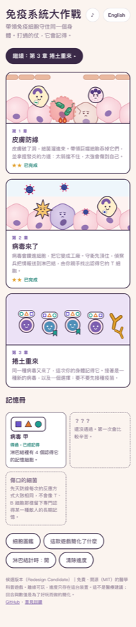 | 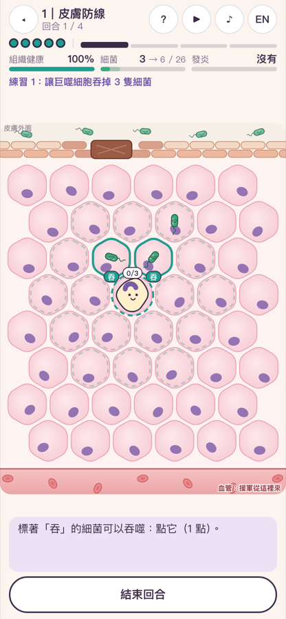 |
| 主選單與記憶冊 | 第 1 章練習 1：進來就能動手 |
| 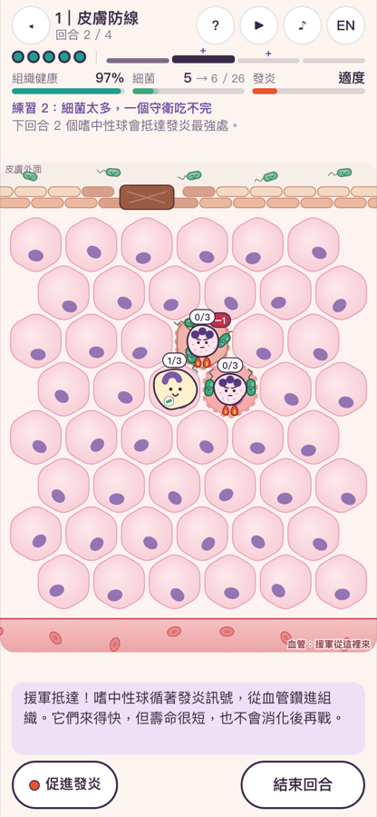 | 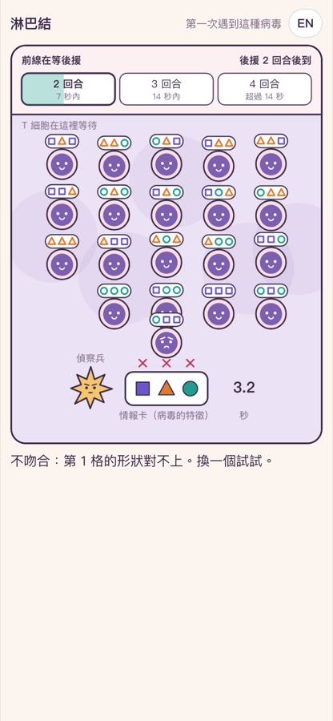 |
| 發炎之後，嗜中性球從血管趕來 | 淋巴結：找出受體吻合的 T 細胞 |
| 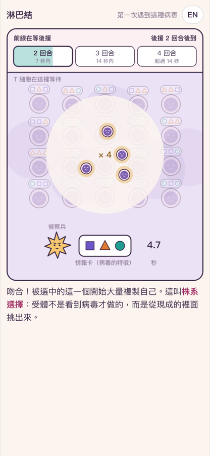 | 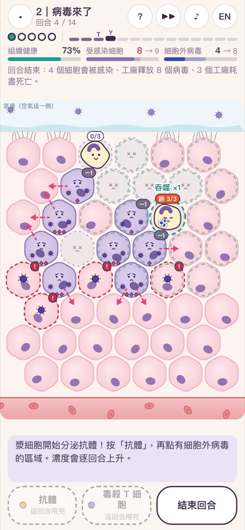 |
| 被選中的細胞大量複製 | 第 2 章：後援抵達後的戰場 |
| 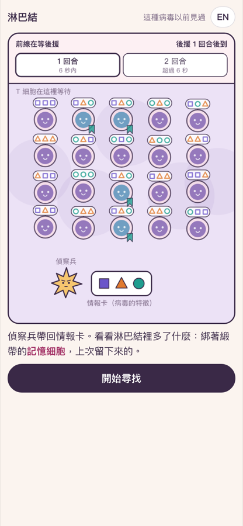 | 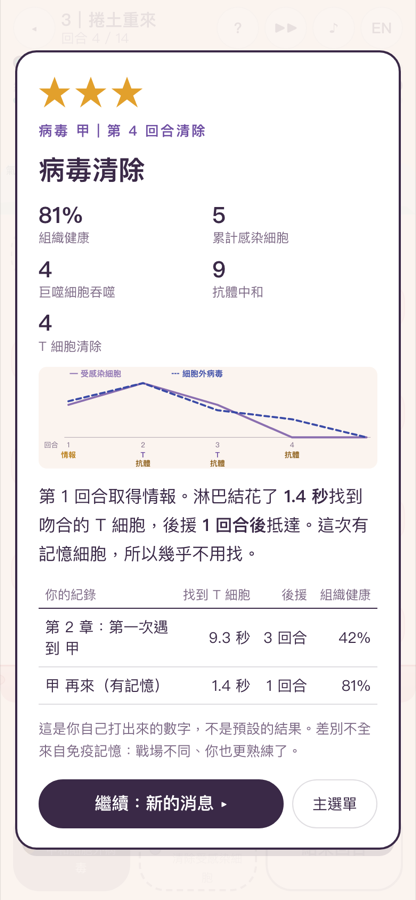 |
| 第 3 章：淋巴結裡多了記憶細胞 | 結算：和自己上一次的紀錄並排 |
| 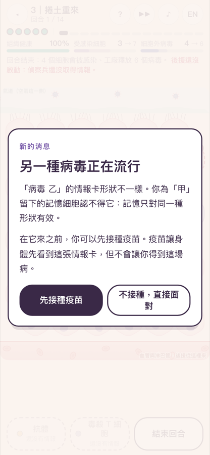 | 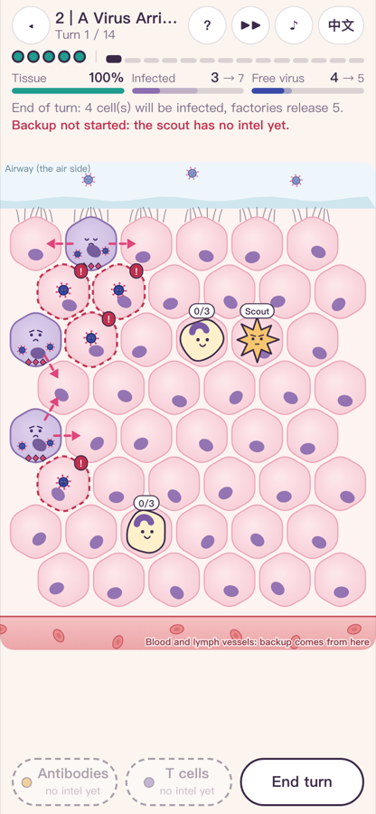 |
| 面對新病毒之前的選擇 | 英文介面 |

桌面與其他畫面：

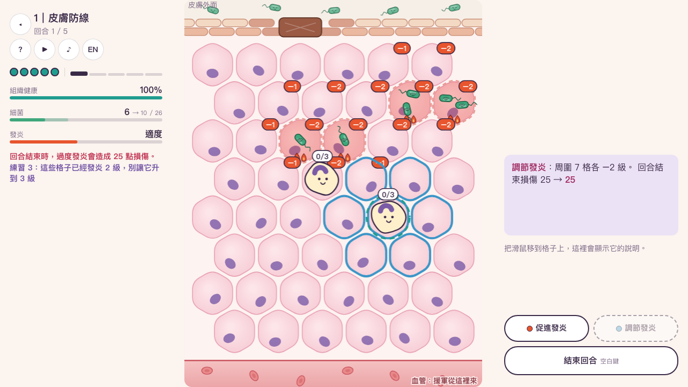
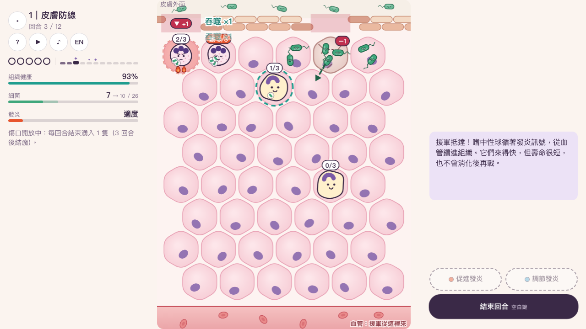
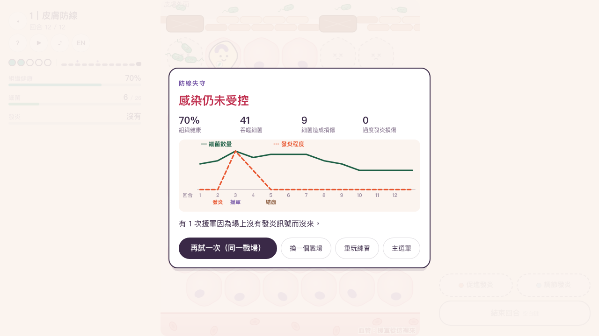
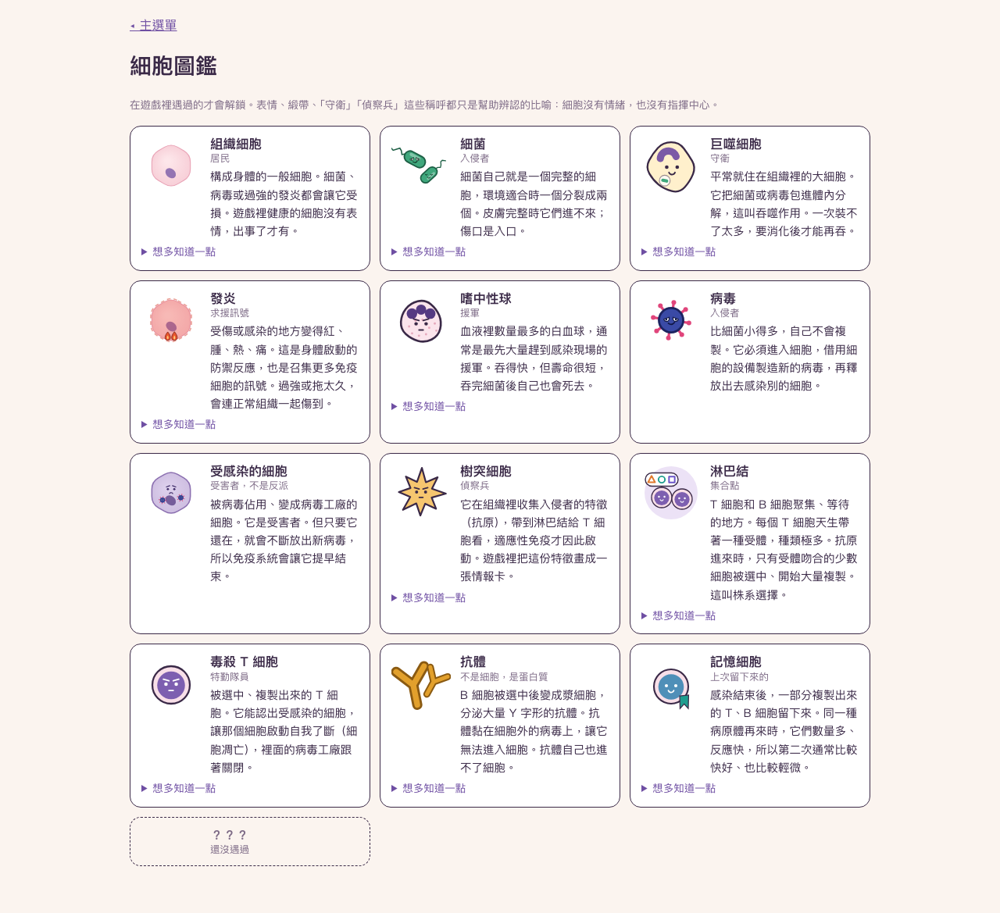
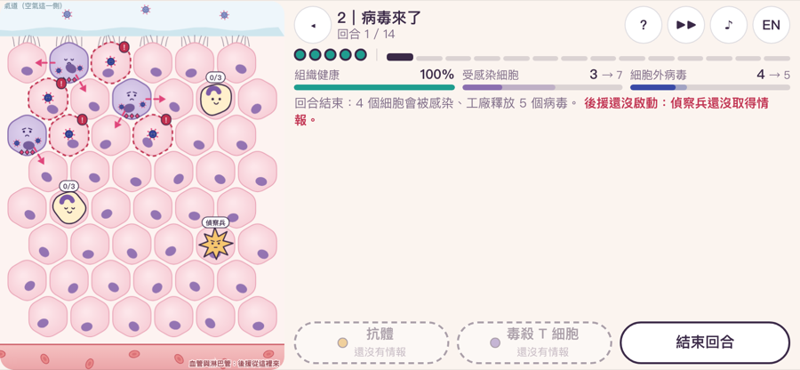
